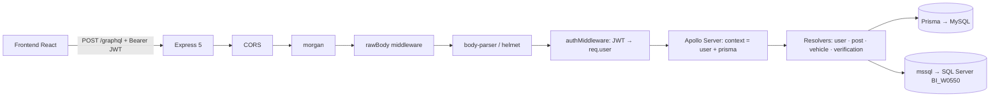
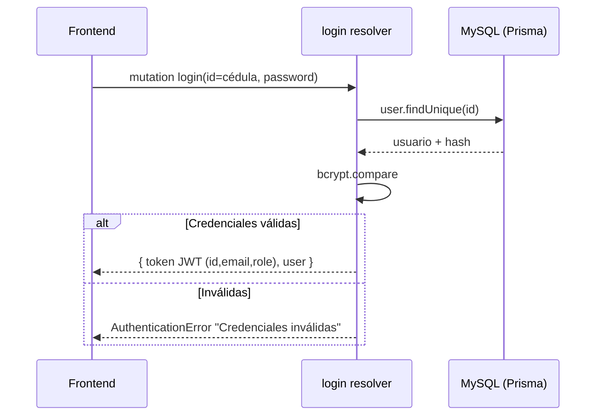
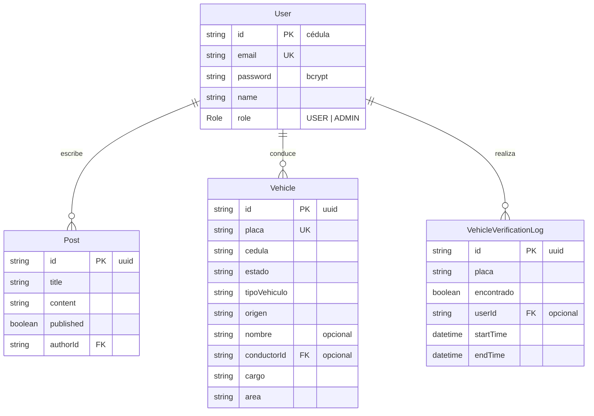

# Documentación Técnica – Backend

API para el sistema de **Verificación de Vehículos (Vehicar / SAO6)**. Desarrollada con **Node.js**, **Express 5**, **Apollo Server 3 (GraphQL)** y **Prisma ORM** sobre **MySQL**, en **TypeScript**. Gestiona autenticación JWT con roles, el catálogo de vehículos (consulta, alta, carga masiva), la bitácora de verificaciones y la consulta del nombre del titular en un **SQL Server** corporativo (`BI_W0550`).

---

## Índice

1. [Stack](#1-stack)
2. [Arquitectura](#2-arquitectura)
3. [Estructura de carpetas](#3-estructura-de-carpetas)
4. [Principios SOLID aplicados](#4-principios-solid-aplicados)
5. [API GraphQL y endpoints](#5-api-graphql-y-endpoints)
6. [Modelo de datos y persistencia](#6-modelo-de-datos-y-persistencia)
7. [Validaciones y reglas de negocio](#7-validaciones-y-reglas-de-negocio)
8. [Servicios externos e integraciones](#8-servicios-externos-e-integraciones)
9. [Autenticación y autorización](#9-autenticación-y-autorización)
10. [Variables de entorno](#10-variables-de-entorno)
11. [Comandos y scripts](#11-comandos-y-scripts)
12. [Despliegue](#12-despliegue)

---

## 1. Stack

| Tecnología | Uso |
| --- | --- |
| Node.js ≥ 18 + TypeScript (`^5.8.3`) | Runtime y lenguaje (`ts-node` en desarrollo, `tsc` → `dist/`) |
| Express (`^5.1.0`) | Servidor HTTP |
| `apollo-server-express` (`^3.13.0`) + `graphql` (`^16.11.0`) | API GraphQL |
| Prisma (`^6.9.0`) + `@prisma/client` | ORM y migraciones (MySQL, `relationMode = "foreignKeys"`) |
| `mysql2` | Driver MySQL |
| `mssql` (`^10.0.1`) | Conexión a SQL Server (consulta de nombres por cédula) |
| `jsonwebtoken` (`^9.0.2`) | Emisión y verificación de JWT |
| `bcrypt` / `bcryptjs` | Hash de contraseñas (10 *salt rounds*) |
| `helmet`, `cors`, `morgan` | Cabeceras de seguridad, CORS y logs HTTP |
| `body-parser` (`^2.2.0`) | Parseo de cuerpo (con *middleware* propio de `rawBody`) |
| `csv-parse` | Importación de vehículos desde `public/CSV.csv` |
| `dotenv` | Variables de entorno |
| `googleapis`, `@google-cloud/local-auth` | Integración con Google Sheets (actualmente desactivada) |
| `nodemon` | Recarga en desarrollo |

---

## 2. Arquitectura



### Pipeline de middleware (`src/index.ts`)

1. **CORS** (con `credentials: true`) – orígenes: `localhost:8080`, `localhost:3000`, `vehicar.sao6.com.co`, `www.vehicar.sao6.com.co`.
2. **morgan (`dev`)** – log de peticiones.
3. **`createRawBodyMiddleware`** – captura el cuerpo crudo de `POST/PUT/PATCH /graphql`; soluciona el error *"stream is not readable"* por la incompatibilidad Express 5 + Apollo Server 3.
4. **`json` / `urlencoded`** (1 MB) – aplicados a todas las rutas **excepto** `/graphql`.
5. **helmet** – CSP, CORP y COEP desactivados para compatibilidad con el frontend.
6. **`authMiddleware`** – decodifica el JWT y adjunta `req.user` (no bloquea si falta; la autorización se hace en los resolvers).
7. **Apollo Server** montado en `/graphql` (`cors: false`, `bodyParserConfig: false`).

### Flujo de login



---

## 3. Estructura de carpetas

```text
backend/
├── .env.example                    # Plantilla de variables de entorno
├── package.json · tsconfig.json · pnpm-lock.yaml
├── prisma/
│   ├── schema.prisma               # Modelos User, Post, Vehicle, VehicleVerificationLog
│   ├── seed.ts                     # Crea el usuario ADMIN inicial
│   └── migrations/                 # 6 migraciones (init → logs de verificación)
├── public/CSV.csv                  # Dataset fuente de vehículos (separador ";")
└── src/
    ├── index.ts                    # Bootstrap: Express + Apollo + Prisma
    ├── config/config.ts            # Configuración centralizada (server, jwt, cors, sqlServer)
    ├── middleware/
    │   ├── auth.ts                 # JWT → req.user
    │   └── rawBody.ts              # Compatibilidad Express 5 / Apollo
    ├── lib/
    │   ├── prisma.ts               # Instancia única de PrismaClient
    │   └── sqlServer.ts            # Pool mssql + getNombreByCedula (con reintentos)
    ├── graphql/
    │   ├── schemas/schema.graphql  # SDL activo (cargado con readFileSync)
    │   ├── schemas/vehicle.schema.ts  # SDL alterno (sin uso)
    │   └── resolvers/
    │       ├── index.ts            # Composición de resolvers
    │       ├── user.resolvers.ts   # Auth y usuarios
    │       ├── post.resolvers.ts   # Posts
    │       ├── vehicle.resolvers.ts        # Vehículos + carga masiva
    │       └── verification.resolvers.ts   # Bitácora de verificaciones
    └── scripts/
        ├── setup.ts · init-dev.ts            # Preparación de entorno
        ├── insert-admin.ts · insert-users.ts · insert-all-users.ts   # Alta de usuarios
        └── importVehiclesData.ts             # Importación CSV → Vehicle
```

---

## 4. Principios SOLID aplicados

| Principio | Aplicación en el backend |
| --- | --- |
| **S – Responsabilidad única** | Un archivo de resolvers por dominio (`user`, `post`, `vehicle`, `verification`); `config.ts` solo configura; `sqlServer.ts` solo accede a SQL Server; `rawBody.ts` solo resuelve la compatibilidad del cuerpo. |
| **O – Abierto/Cerrado** | `resolvers/index.ts` compone el mapa final con *spread*; agregar un dominio nuevo es añadir un archivo y una línea, sin tocar los existentes. |
| **L – Sustitución de Liskov** | Los resolvers siguen el contrato del SDL (tipos y nulabilidad); cualquier implementación que respete el tipo puede reemplazarlos. |
| **I – Segregación de interfaces** | Inputs GraphQL específicos por caso de uso (`CreateVehicleInput`, `BulkVehicleInput`, `VehicleVerificationInput`, `LoginUserInput`…) en lugar de un input genérico. |
| **D – Inversión de dependencias** | Los resolvers reciben `context` (`user`, `prisma`) inyectado por Apollo; el acceso a SQL Server está tras la función `getNombreByCedula`, desacoplando la fuente del nombre. |

---

## 5. API GraphQL y endpoints

### Endpoints HTTP

| Método | Ruta | Descripción |
| --- | --- | --- |
| `POST` | `/graphql` | API GraphQL (Apollo Server, puerto por defecto **4000**) |
| `GET` | `/api/health` | *Health check*: `{ status: "ok", time }` |
| `GET` | `/` | Mensaje de verificación del servicio |

### Queries

| Query | Auth | Descripción |
| --- | --- | --- |
| `me` | Usuario | Perfil del usuario autenticado |
| `users` | `ADMIN` | Lista de usuarios |
| `user(id)` | Propio o `ADMIN` | Usuario por cédula |
| `posts` / `post(id)` | Público | Posts publicados |
| `postsByUser(userId)` | Usuario | Posts de un autor (no publicados solo para dueño/admin) |
| `getVehicleByPlaca(placa)` | Pública | Vehículo por placa; completa `nombre` desde SQL Server por cédula |
| `getVehicleByCedula(cedula)` | — | Declarada en el SDL, **sin resolver implementado** |
| `getAllVehicles(skip, take)` | Pública | Listado paginado (por defecto `take=10`), orden `createdAt desc` |
| `getVehiclesByPlacas(placas)` | Pública | Vehículos por lista de placas (conciliación Excel) |
| `getVehicleVerificationLogs(skip, take)` | Pública | Bitácora paginada con usuario, orden `startTime desc` |
| `getNombreByCedula(cedula)` | Pública | Nombre del titular en SQL Server |
| `testUsers` | Pública | Hasta 10 usuarios de prueba (ver [sección 13](#13-deuda-técnica-y-puntos-de-atención)) |

### Mutations

| Mutation | Auth | Descripción |
| --- | --- | --- |
| `login(id, password)` | Pública | Devuelve `{ token, user }` |
| `signup(input)` | Pública | Registro por email; devuelve `{ token, user }` |
| `updateUser(id, name, email, role)` | `ADMIN` | Actualiza datos y rol |
| `deleteUser(id)` | `ADMIN` | Elimina (protege a `administrador_jorge`) |
| `changePassword(id, currentPassword, newPassword)` | Propio o `ADMIN` | Requiere contraseña actual |
| `createPost` / `updatePost` / `deletePost` / `publishPost` | Usuario | CRUD de posts del autor |
| `logVehicleVerification(input)` | Pública | Registra una verificación |
| `createVehicle(input)` | Pública | Alta individual |
| `bulkInsertVehicles(vehicles)` | Pública | Inserción/actualización masiva (lotes de 50) |
| `updateVehicleCedula(placa, cedula)` | Pública | Corrige la cédula y re-vincula al conductor |

### Ejemplo

```graphql
mutation {
  login(id: "1003395739", password: "••••••") {
    token
    user { id name role }
  }
}
```

```http
POST /graphql
Authorization: Bearer <token>
```

---

## 6. Modelo de datos y persistencia



- **`User.id` = cédula** (decisión de migración `cambio_cedula_como_id`); el administrador usa el id `administrador_jorge`.
- **`Vehicle.placa`** es única; `conductorId` es opcional (la cédula del archivo puede no tener usuario registrado).
- Todas las tablas tienen `createdAt` / `updatedAt` (`@updatedAt`).

### Migraciones (`prisma/migrations`)

| Migración | Cambio |
| --- | --- |
| `20250604195417_init` | Esquema inicial |
| `20250604200344_cambio_cedula_como_id` | Cédula como identificador de usuario |
| `20250604210809` / `211648_add_vehicle_model` | Modelo `Vehicle` |
| `20250606141642_add_vehicle_verification_logs` | Bitácora de verificaciones |
| `20250606152123_make_conductor_id_optional` | `conductorId` opcional |

### Estrategia de acceso a datos
- `lib/prisma.ts` exporta una instancia compartida; las conexiones se abren con `prisma.$connect()` al iniciar y se cierran ante fallo de arranque.
- `getVehicleByPlaca` usa `$queryRaw` con *join* a `User`; el resto usa el cliente Prisma.
- SQL Server se accede con un **pool** (`max 10`, timeout 30 s) con reconexión automática.

---

## 7. Validaciones y reglas de negocio

- **Normalización de placas**: siempre `toUpperCase().trim()` antes de consultar, crear o comparar.
- **Placa inexistente** en `getVehicleByPlaca` → `UserInputError` ("No se encontró ningún vehículo…").
- **`createVehicle`**: rechaza placas duplicadas; valores por defecto `estado=ACTIVO`, `tipoVehiculo=AUTOMOVIL`, `origen=REGISTRO`, `cargo=NO ESPECIFICADO`, `area=GENERAL`; solo asocia `conductorId` si el usuario existe.
- **`bulkInsertVehicles`**:
  1. Normaliza todo el lote y detecta existentes en una sola consulta.
  2. Inserta nuevos con `createMany` en **lotes de 50** (`skipDuplicates`).
  3. Actualiza existentes uno a uno.
  4. Vincula `conductorId` solo cuando existe un `User` con esa cédula.
  5. Devuelve `insertedCount`, `updatedCount`, `skippedCount`, `errors` (máx. 10) y `message`.
- **`logVehicleVerification`**: exige `placa`, `encontrado` booleano y `endTime`; `startTime` por defecto = ahora; fechas devueltas en ISO 8601.
- **Usuarios**: `signup` rechaza email duplicado; `deleteUser` bloquea al admin principal; `changePassword` verifica la contraseña vigente.
- **Errores**: `formatError` devuelve solo `message`, `locations` y `path` (sin *stack*); `debug` activo solo fuera de producción.

---

## 8. Servicios externos e integraciones

| Servicio | Integración |
| --- | --- |
| **MySQL** | Base principal vía Prisma (`DATABASE_URL`). |
| **SQL Server `BI_W0550`** | `lib/sqlServer.ts`: consulta `SELECT TOP 1 f200_razon_social FROM dbo.BI_W0550 WHERE F200_ID = @cedula` (parametrizada). Hasta **3 reintentos** (1 s) ante `ECONNCLOSED`, `ENOTOPEN`, `ETIMEOUT`; cierre ordenado del pool en `SIGINT`/`SIGTERM`. Si falla, el campo `nombre` queda `null` sin romper la consulta. |
| **Google Sheets** | Dependencias y variables previstas (`GOOGLE_SHEETS_*`), pero el guardado en Sheets está **comentado/desactivado** en `createVehicle` y `logVehicleVerification`. |
| **CSV de origen** | `public/CSV.csv` (`;`, UTF-8 con BOM): `CÉDULA;PLACA;Estado;Tipo de vehiculo;Origen;Nombre;Cargo;Area`; lo consume `importVehiclesData.ts`. |

---

## 9. Autenticación y autorización

- **Emisión**: `jwt.sign({ id, email, role }, JWT_SECRET, { expiresIn: JWT_EXPIRATION })` (por defecto **1 día**).
- **Transporte**: cabecera `Authorization: Bearer <token>`.
- **Verificación**: `authMiddleware` decodifica y adjunta `req.user`; un token inválido solo se registra en log y la petición continúa como anónima.
- **Autorización**: en cada resolver sobre `context.user`:
  - sin usuario → `AuthenticationError('No estás autenticado')`;
  - rol distinto de `ADMIN` en operaciones administrativas → `AuthenticationError('No tienes permisos…')`.
- **Contraseñas**: `bcrypt.hash(password, 10)`; nunca se devuelven en el SDL.
- **Roles** (`enum Role`): `USER`, `ADMIN`.

| Operación | Anónimo | USER | ADMIN |
| --- | :-: | :-: | :-: |
| `login`, `signup` | ✔ | ✔ | ✔ |
| Consultar placas / registrar verificación | ✔ | ✔ | ✔ |
| `me`, `changePassword` (propio) | ✘ | ✔ | ✔ |
| `users`, `updateUser`, `deleteUser` | ✘ | ✘ | ✔ |

---

## 10. Variables de entorno

Plantilla en `backend/.env.example` (copiar a `.env`, que está en `.gitignore`).

| Variable | Uso | Valor por defecto |
| --- | --- | --- |
| `PORT` | Puerto HTTP | `4000` |
| `NODE_ENV` | Entorno (`production` desactiva `debug` de Apollo) | `development` |
| `JWT_SECRET` | Firma de tokens | `default_secret_change_in_production` ⚠ |
| `JWT_EXPIRATION` | Vigencia del token | `1d` |
| `CORS_ORIGIN` | Orígenes permitidos | `*` (nota: `index.ts` usa una lista fija) |
| `DATABASE_URL` | Conexión MySQL de Prisma | — |
| `SQL_SERVER_HOST` / `_DATABASE` / `_USER` / `_PASSWORD` / `_PORT` | SQL Server | `localhost` / `BI_W0550` / — / — / `1433` |
| `SQL_SERVER_ENCRYPT` / `SQL_SERVER_TRUST_CERT` | Opciones TLS de mssql | `false` |
| `GOOGLE_SHEETS_CREDENTIALS_PATH` / `GOOGLE_SHEETS_SPREADSHEET_ID` | Google Sheets (opcional) | — |

---

## 11. Comandos y scripts

```bash
cd backend
pnpm install            # Instalación de dependencias
cp .env.example .env    # Configurar variables

pnpm prisma:generate    # Generar cliente Prisma
pnpm prisma:migrate     # Aplicar migraciones (dev)
pnpm prisma:seed        # Crear usuario administrador
pnpm prisma:studio      # Explorador visual de la BD

pnpm dev                # nodemon + ts-node (http://localhost:4000/graphql)
pnpm build              # tsc -> dist/
pnpm start              # node dist/index.js

pnpm setup              # Verifica .env, genera Prisma y migra
pnpm init-dev           # Copia .env.development a .env y migra
pnpm insert-admin       # Crea/actualiza el administrador
pnpm insert-users       # Inserta usuarios predefinidos
```

Importación de vehículos desde CSV: `npx ts-node src/scripts/importVehiclesData.ts` (crea usuarios y vehículos a partir de `public/CSV.csv`).

---

