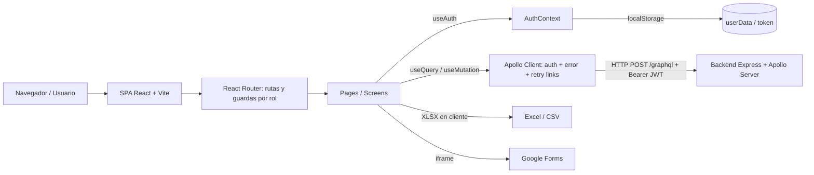
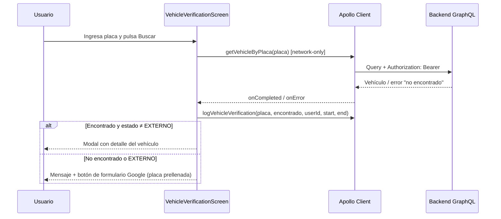
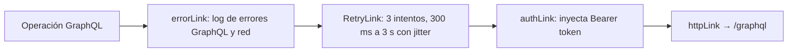

# Documentación Técnica – Frontend

Aplicación web SPA para el sistema de **Verificación de Vehículos (Vehicar / SAO6)**. Desarrollada con **React 18**, **Vite 5** y **TypeScript**, permite a los usuarios consultar en tiempo real si una placa está registrada, registrar cada consulta como auditoría, solicitar el registro de placas no encontradas (formulario de Google embebido), y ofrece a los administradores un panel con estadísticas, bitácora de búsquedas y gestión de usuarios. Un perfil especial de **RRHH** carga y concilia masivamente vehículos desde archivos Excel/CSV.

---

## Índice

1. [Stack](#1-stack)
2. [Arquitectura](#2-arquitectura)
3. [Estructura de carpetas](#3-estructura-de-carpetas)
4. [Principios SOLID aplicados](#4-principios-solid-aplicados)
5. [Páginas, rutas y control de acceso](#5-páginas-rutas-y-control-de-acceso)
6. [Estado global, caché y persistencia](#6-estado-global-caché-y-persistencia)
7. [Validaciones y reglas de negocio en cliente](#7-validaciones-y-reglas-de-negocio-en-cliente)
8. [Servicios externos e integraciones](#8-servicios-externos-e-integraciones)
9. [Autenticación y manejo de sesión](#9-autenticación-y-manejo-de-sesión)
10. [Variables de entorno y configuración](#10-variables-de-entorno-y-configuración)
11. [Comandos](#11-comandos)
12. [Despliegue](#12-despliegue)
---

## 1. Stack

| Tecnología | Uso |
| --- | --- |
| React (`^18.3.1`) + `react-dom` | Librería de UI |
| Vite (`^5.4.1`) + `@vitejs/plugin-react-swc` | Bundler y servidor de desarrollo (puerto **8080**) |
| TypeScript (`^5.5.3`) | Tipado estático (`tsconfig.app.json`, alias `@/` → `src/`) |
| `react-router-dom` (`^6.26.2`) | Enrutamiento SPA (`BrowserRouter`) |
| `@apollo/client` (`^3.13.8`) + `graphql` | Cliente GraphQL, caché normalizada, links de auth/error/retry |
| `@tanstack/react-query` (`^5.56.2`) | Provider disponible (caché `staleTime` 5 min); la data de negocio se maneja con Apollo |
| Tailwind CSS (`^3.4.11`) + `tailwindcss-animate` | Estilos utilitarios y animaciones (`animate-float`, `fade-in-up`, etc.) |
| Radix UI + shadcn/ui (`src/components/ui/`) | Componentes accesibles (Dialog, Tabs, Select, Toast, etc.) |
| MUI (`@mui/material`, `@mui/icons-material` `^7.1.1`) + Emotion | Usado en `VehicleVerification.tsx` (vista pública de consulta) |
| `lucide-react` | Iconografía |
| `recharts` (`^2.12.7`) | Gráficas del panel administrador |
| `xlsx` (`^0.18.5`) | Lectura/escritura de Excel y CSV en navegador |
| `react-dropzone` (`^14.3.8`) | Carga de archivos *drag & drop* en el panel RRHH |
| `react-hook-form` + `zod` + `@hookform/resolvers` | Formularios y validación declarativa |
| `date-fns` (`^3.6.0`) | Filtros por período (hoy, semana, mes, 7/30 días) |
| `react-hot-toast`, `sonner`, Radix Toast | Notificaciones (tres sistemas conviven) |
| `driver.js` (`^1.3.6`) | Tour guiado de onboarding (`styles/driver-custom.css`) |
| `next-themes` | Soporte de tema claro/oscuro |
| Google Forms (iframe) | Solicitud de registro de placas no encontradas |
| `lovable-tagger` | Etiquetado de componentes en modo desarrollo (Lovable) |

---

## 2. Arquitectura



### Flujo principal de una verificación de placa



### Capas

| Capa | Responsabilidad | Ubicación |
| --- | --- | --- |
| Presentación | Pantallas y componentes visuales | `src/pages`, `src/components` |
| UI base | Primitivas reutilizables (shadcn/Radix) | `src/components/ui` |
| Estado de sesión | Usuario autenticado, login/logout | `src/contexts/AuthContext.tsx` |
| Acceso a datos | Documentos GraphQL y cliente Apollo | `src/graphql`, `src/lib/apolloClient.ts` |
| Servicios | Orquestación de llamadas al backend | `src/services/userService.ts` |
| Lógica derivada | Agregaciones/filtros de gráficas | `src/hooks/use-chart-data.ts` |
| Tipos y constantes | Contratos TS y paleta de colores | `src/types`, `src/constants` |

---

## 3. Estructura de carpetas

```text
Formulario-Placas/
├── index.html                      # Entrada HTML de Vite
├── vite.config.ts                  # Puerto 8080, alias "@", plugin SWC
├── tailwind.config.ts · postcss.config.js · components.json (shadcn)
├── eslint.config.js · tsconfig*.json
├── public/                         # favicon, placeholder
└── src/
    ├── main.tsx                    # Montaje: ApolloProvider + AuthProvider + App
    ├── App.tsx                     # Providers (Query, Tooltip, Toasters) y <Routes>
    ├── index.css · App.css         # Estilos globales y tokens Tailwind
    ├── pages/
    │   ├── Index.tsx               # Landing: decide Login / Admin / Verificación según sesión
    │   └── NotFound.tsx            # Ruta 404
    ├── components/
    │   ├── LoginScreen.tsx         # Login con cédula y contraseña
    │   ├── VehicleVerificationScreen.tsx  # Pantalla principal de consulta (usuario)
    │   ├── VehicleVerification.tsx        # Vista pública alternativa (MUI)
    │   ├── AdminDashboard.tsx      # Contenedor del panel administrador
    │   ├── AnimatedLogo.tsx
    │   ├── dashboard-admin/        # Tabs, tarjetas, gráficas, bitácora, usuarios
    │   │   ├── dashboard-header.tsx · dashboard-tabs.tsx · stats-cards.tsx
    │   │   ├── dashboard-content.tsx · dashboard-content-with-charts.tsx
    │   │   ├── charts/ (user-activity · plates · hourly-activity)
    │   │   ├── search-logs-table.tsx
    │   │   ├── user-management-simple.tsx · users-table.tsx · user-form.tsx
    │   │   └── settings-content.tsx
    │   ├── excel/ExcelDataLoader.tsx      # Panel RRHH: carga/edición/exportación masiva
    │   └── ui/                     # ~50 primitivas shadcn/Radix
    ├── contexts/AuthContext.tsx    # Proveedor y hook useAuth
    ├── graphql/                    # auth.ts · users.ts · search-records.ts
    ├── hooks/                      # use-chart-data · use-mobile · use-toast
    ├── lib/                        # apolloClient.ts (activo) · apollo-client.ts · router.tsx · utils.ts
    ├── services/userService.ts     # login / getCurrentUser
    ├── constants/dashboard-constants.ts   # Paleta verde y chartConfig
    ├── types/dashboard-types.ts    # SearchRecord, AdminDashboardProps…
    └── styles/                     # dashboard-styles.tsx · driver-custom.css
```

---

## 4. Principios SOLID aplicados

| Principio | Aplicación en el frontend |
| --- | --- |
| **S – Responsabilidad única** | El panel admin se divide en piezas con una sola función: `dashboard-header`, `dashboard-tabs`, `stats-cards`, `search-logs-table`, `users-table`, `user-form`. La lógica de agregación de gráficas vive aparte en `useChartData`, no en los componentes visuales. |
| **O – Abierto/Cerrado** | Los gráficos reciben `data`, `period` y `onPeriodChange` por props; agregar un gráfico nuevo (p. ej. otro `*-chart.tsx`) no modifica los existentes. Las primitivas `ui/` se extienden por `className`/variantes (`class-variance-authority`). |
| **L – Sustitución de Liskov** | Los componentes `ui/*` envuelven primitivas Radix manteniendo su contrato de props, por lo que son intercambiables con el original. |
| **I – Segregación de interfaces** | Interfaces pequeñas por componente (`DashboardTabsProps`, `VehicleVerificationScreenProps`, `AdminDashboardProps`) en lugar de un objeto de contexto único. |
| **D – Inversión de dependencias** | Los componentes dependen de la abstracción `useAuth()` y de documentos GraphQL (`src/graphql`), no de `fetch`/`localStorage` directos; el cliente Apollo se inyecta vía `ApolloProvider`. |

---

## 5. Páginas, rutas y control de acceso

Definidas en `src/App.tsx` con `BrowserRouter`. Las guardas son **condicionales en el elemento** (si no cumple, renderiza `<Index />`, que muestra el login).

| Ruta | Componente | Acceso | Descripción |
| --- | --- | --- | --- |
| `/` | `Index` | Público | Según la sesión muestra `LoginScreen`, `AdminDashboard` (rol `ADMIN`) o `VehicleVerificationScreen` (usuario normal). Incluye transición animada al cerrar sesión. |
| `/verificar-vehiculo` | `VehicleVerification` | Público | Consulta de placa con tabla de resultados (MUI). |
| `/verificacion` | `VehicleVerificationScreen` | Requiere `userData` | Consulta principal con modal de detalle, historial y formulario de placa no encontrada. |
| `/admin` | `AdminDashboard` | `userData.isAdmin` | Panel con pestañas **Dashboard / Usuarios / Configuración**. |
| `/rrhh` | `ExcelDataLoader` | `userData.isRRHH` | Carga masiva y conciliación de vehículos desde Excel/CSV. |
| `*` | `NotFound` | Público | 404. |

### Pantallas clave

- **`LoginScreen`**: formulario cédula + contraseña; llama `useAuth().login`.
- **`VehicleVerificationScreen`**: input de placa con sugerencias, búsqueda `network-only`, modal con pestañas de información, y *fallback* al formulario de Google cuando la placa no existe o su estado es `EXTERNO`.
- **`AdminDashboard`**: carga hasta **1000** logs (`getVehicleVerificationLogs`), los transforma a `SearchRecord[]` y alimenta tarjetas, gráficas y tabla.
  - **Dashboard**: `stats-cards` + 3 gráficas (actividad por usuario, placas más buscadas, actividad por hora) con filtro de período.
  - **Usuarios**: alta, edición, eliminación y cambio de contraseña.
  - **Configuración**: ajustes (`settings-content`).
- **`ExcelDataLoader`**: ver [sección 7](#7-validaciones-y-reglas-de-negocio-en-cliente).

---

## 6. Estado global, caché y persistencia

| Mecanismo | Contenido | Detalle |
| --- | --- | --- |
| `AuthContext` (React Context) | `user`, `isLoading`, `error`, `login()`, `logout()` | Proveedor en `main.tsx` y `App.tsx`. |
| `localStorage` | `userData`, `token`, `authToken`, `user` | Ver advertencia de claves inconsistentes en [sección 9](#9-autenticación-y-manejo-de-sesión). |
| Apollo `InMemoryCache` | Resultados GraphQL | `Vehicle` se identifica por `placa` (`keyFields`); `getAllVehicles` se reemplaza en cada merge. |
| Apollo `defaultOptions` | Políticas de fetch | `watchQuery`: `cache-and-network` con *polling* cada 5 min; `query`: `cache-first`; `errorPolicy: 'all'`. Las pantallas críticas (verificación y admin) fuerzan `network-only`. |
| Estado local (`useState`) | Filtros, paginación, selección, edición en fila | Cada pantalla gestiona el suyo. |
| React Query | `QueryClient` con `staleTime` 5 min y `retry: false` | Provider registrado; sin consultas de negocio asociadas actualmente. |

### Resiliencia de red (`src/lib/apolloClient.ts`)



---

## 7. Validaciones y reglas de negocio en cliente

### Verificación de placa
- La placa no puede estar vacía (`toast.error` y se aborta).
- Se evita doble envío mientras `isLoading` es verdadero.
- **Regla `EXTERNO`**: un vehículo con `estado` = `EXTERNO` (comparación normalizada `trim + upper`) se trata como **no encontrado**.
- Cada búsqueda registra `logVehicleVerification` con `placa`, `encontrado`, `userId` (cédula), `startTime` y `endTime` (se usa para calcular la duración de sesión en el admin).
- Si no se encuentra, se conserva la placa en `lastSearchedPlaca` y se prellena en el formulario de Google (`entry.2005620554`).

### Panel RRHH – Carga masiva (`ExcelDataLoader`)
- Formatos aceptados: `.xlsx`, `.xls`, `.csv` (una sola hoja: la primera).
- **Normalización de columnas** tolerante a variaciones (`tipo de vehiculo`/`vehículo`/`tipo`, `area`/`área`, etc.) y mapeo a `CÉDULA, PLACA, Estado, Tipo de vehículo, Origen, Nombre, Cargo, Area`.
- **Detección de placas duplicadas** dentro del archivo (aviso con toast).
- Cada fila recibe un `_uniqueId` para evitar *keys* duplicadas en React.
- Conciliación con la base (`getVehiclesByPlacas`) para identificar registros ya guardados; edición de cédula por fila (`updateVehicleCedula`).
- Inserción masiva con `bulkInsertVehicles` (el backend responde `insertedCount`, `updatedCount`, `skippedCount`, `errors`).
- Funciones adicionales: selección múltiple, edición en línea, alta manual, filtros, paginación y **exportación** a `vehiculos_exportados_YYYY-MM-DD.xlsx`.

### Panel administrador
- Filtros por período con `date-fns`: `today`, `week`, `month`, `7days`, `30days`.
- Duración de sesión calculada como `endTime − startTime` por búsqueda.
- Gestión de usuarios con validación (`react-hook-form` + `zod`) y restricción backend: no se elimina `administrador_jorge`.

---

## 8. Servicios externos e integraciones

| Servicio | Integración |
| --- | --- |
| **Backend GraphQL** | `POST http://localhost:4000/graphql` (URL fija en `apolloClient.ts`); ver *DOCUMENTACION_BACKEND.md*. |
| **Google Forms** | `iframe` embebido en `VehicleVerificationScreen.tsx` (`.../viewform?embedded=true&hl=es`) con la placa buscada en `entry.2005620554`. |
| **Excel / CSV** | Procesamiento 100 % en navegador con `xlsx` + `react-dropzone`; exportación con `XLSX.writeFile`. |
| **driver.js** | Tour guiado inicial (`VehicleVerification.tsx`). |

### Operaciones GraphQL consumidas

| Documento | Tipo | Archivo | Uso |
| --- | --- | --- | --- |
| `LOGIN_MUTATION` | Mutation | `graphql/auth.ts` | Inicio de sesión |
| `CURRENT_USER_QUERY` | Query | `graphql/auth.ts` | Usuario actual (`me`) |
| `GET_VEHICLE_BY_PLACA` | Query | `VehicleVerification*.tsx` | Consulta de placa |
| `LOG_VEHICLE_VERIFICATION` | Mutation | `graphql/search-records.ts` | Registro de auditoría |
| `GET_VEHICLE_VERIFICATION_LOGS` | Query | `graphql/search-records.ts` | Bitácora del admin |
| `GET_ALL_USERS`, `CREATE_USER`, `UPDATE_USER`, `DELETE_USER`, `CHANGE_PASSWORD` | Query/Mutation | `graphql/users.ts` | Gestión de usuarios |
| `BULK_INSERT_VEHICLES`, `GET_VEHICLES_BY_PLACAS`, `UPDATE_VEHICLE_CEDULA` | Mutation/Query | `graphql/users.ts` | Panel RRHH |

---

## 9. Autenticación y manejo de sesión

- **Inicio de sesión (`AuthContext.login`)**: ejecuta `login(id, password)`. Si responde `token` y `user`, calcula `isAdmin = role === 'ADMIN'`, y guarda `userData` y `token` en `localStorage`.
- **Perfil RRHH**: la cédula `RRHH` con una contraseña fija se resuelve **en el cliente** (sin llamada al backend), crea un usuario `isRRHH: true` y habilita `/rrhh`.
- **Cabeceras de petición (`apolloClient.ts`)**: `authLink` envía `Authorization: Bearer <authToken>` leído de `localStorage`.
- **Restauración de sesión**: al montar, `AuthProvider` y `App` leen `localStorage` para rehidratar al usuario.
- **Cierre de sesión**: limpia `localStorage`, `setUser(null)` y `apolloClient.resetStore()`; `Index` aplica una transición animada de ~500 ms.
- **Autorización de vistas**: por `isAdmin` / `isRRHH` en `App.tsx` (control de UX; la autorización real se valida en el backend por rol del JWT).

---

## 10. Variables de entorno y configuración

El frontend **no usa variables de entorno** actualmente; los valores están fijos en código:

| Valor | Ubicación | Observación |
| --- | --- | --- |
| URL GraphQL `http://localhost:4000/graphql` | `src/lib/apolloClient.ts` y `src/lib/apollo-client.ts` | Debe parametrizarse (p. ej. `VITE_API_URL`) para producción. |
| Puerto de desarrollo `8080` | `vite.config.ts` | `host: "::"`. |
| ID del Google Form y entry de placa | `VehicleVerificationScreen.tsx` | Cambiar si se reemplaza el formulario. |

---

## 11. Comandos

```bash
pnpm install        # Instalación de dependencias
pnpm dev            # Servidor de desarrollo Vite (http://localhost:8080)
pnpm build          # Build de producción -> dist/
pnpm build:dev      # Build en modo development
pnpm preview        # Vista previa del build
pnpm lint           # ESLint
```

---

## 12. Despliegue

El repositorio **no incluye** un workflow de CI/CD (`.github/`). El build es estático (`dist/`) y puede servirse con cualquier servidor web (Nginx, Apache) con *fallback* a `index.html` para el enrutado SPA. El backend permite CORS para `localhost:8080`, `localhost:3000` y `vehicar.sao6.com.co`, que es el dominio previsto de producción.

Pasos recomendados:

1. Definir la URL del backend de producción (ver sección 10) y compilar con `pnpm build`.
2. Publicar `dist/` en el servidor web con reescritura de rutas a `/index.html`.
3. Verificar que el dominio del frontend esté en la lista CORS del backend.

---
